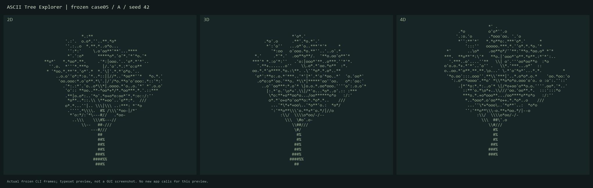

# Codex Flow

[English](README.md) · [Начало работы](docs/getting-started.md) · [Архитектура](docs/architecture.md) · [Ограничения](docs/limitations.md)

Codex Flow развивает существующий skill версии 1.2.0: к его маршрутам работы и офлайн-установщику добавлен **проектный runtime с явным включением**. Он запускает штатный Codex CLI, координирует независимые подзадачи, сохраняет диагностику и позволяет проводить контролируемые A/B-эксперименты.

Главный профиль — `gpt-6.1-sol`, reasoning `xhigh`. Mercury и локальные пробы по мотивам Harness² по умолчанию выключены. Репозиторий пока приватный; лицензия проекта не выбрана. Универсальное ускорение или экономия квоты не доказаны.

## Первый запуск

Нужны Python 3.11+ и уже установленный Codex CLI. Для бенчмарка предпочтителен Python 3.12. Runtime использует стандартную библиотеку, не устанавливает зависимости и не создаёт платные API-подключения.

```powershell
python codex-flow.py --help
python codex-flow.py doctor
python codex-flow.py run "Описать небольшую согласованную задачу" --dry-run
```

`doctor` проверяет CLI и вход по подписке без генерации ответа. `doctor --deep` дополнительно читает через CLI метаданные аккаунта и доступных моделей. Это не проверка успешной генерации.

Для выполнения после просмотра плана:

```powershell
python codex-flow.py --repo <project> run "Выполни согласованную задачу" --enable --single-agent
```

Замените `<project>` реальным путём. Глобальные параметры `--repo`, `--codex`, `--config` указываются перед подкомандой. Используется существующий вход ChatGPT; генерация расходует квоту подписки. Автоматический переход на платный API запрещён.

## Реально доступные команды

| Команда | Что делает |
|---|---|
| `doctor [--deep]` | Проверка CLI/входа; опционально метаданные моделей |
| `integrations status` | Показывает настройки интеграций без заявления о доступности |
| `run` | Планирует маршрут и при явном включении запускает задачу |
| `runs list/show/cancel/replay` | Метрики, запрос отмены и сводка сохранённых событий |
| `benchmark tree/report` | Запуск A/B с абляциями или чтение собранных метрик |

Runtime не содержит TUI, живого dashboard или команды `resume`. `runs replay` разбирает журнал и не повторяет вызовы модели. Разговорные маршруты review/resume/checkpoint исходного skill сохранены отдельно.

## Агенты и интеграции

Параллельный маршрут зависит от числа независимых шагов и владения файлами. Координатор объединяет результаты и остаётся автором приложения; помощники собирают независимые свидетельства и выполняют review. `--single-agent` либо `--strategy single` выбирает одиночную работу. `--strategy parallel` не отменяет проверку независимости. `--max-agents` принимает 1–3: это нативный предел одновременно работающих помощников. Пользовательские роли наследуют разрешения родителя; их read-only-режим, общее число помощников и глубина делегирования ограничены инструкциями, без отдельного жёсткого sandbox для каждой роли.

Mercury подключается только через явно выбранный внешний free-only adapter. Его исходники и ключи не входят в поставку. Текущая версия прошла реальную проверку typed-решения с подтверждённой нулевой стоимостью после передачи существующего системного прокси Windows в дочерний Node через `--use-env-proxy`. Модель, build и provider проверены; значения прокси не записывались в журнал, глобальные настройки не менялись. По умолчанию Mercury выключен. Ранее замороженный бенчмарк использует прежнюю версию с 0 успешных вызовов: поздняя проверка не меняет задним числом его статус.

Локальный механизм по мотивам Harness² сравнивает измеренные пробы плана, хранит предложение и допускает ограниченное принятие с откатом. Он не запускает upstream-исполнитель Harness². При явной настройке пробы выполняются и в обычном `run`, и в бенчмарке, расходуя время и квоту подписки. Результат помечен degraded: покрытие полей плана не доказывает качество будущего приложения.

## Границы безопасности

Runtime выключен до `--enable` или настройки проекта. Loopback gateway принимает запросы только с одноразовым секретом текущего запуска и пересылает их на фиксированный официальный адрес подписки. Общий жёсткий бюджет — до 80 inference-запросов, включая пробы. Авторизацию передаёт штатный CLI в памяти: токены не копируются в проект, глобальные конфиги не переписываются. Журнал разделяет запрошенные model/effort, фактическую модель ответа и usage; effort не подтверждается отдельным полем ответа.

Одиночная сессия ephemeral. Родитель параллельного запуска сохраняется: нативным помощникам нужен rollout родителя. Пути SQLite и логов, HOME/temp/cache размещаются в проекте; контейнер штатной авторизации и rollout остаётся общим. **Отдельные пути не означают отдельный контекст:** native CLI может восстановить исторические метаданные чужих задач из общего rollout-контейнера в локальную SQLite. Это подтверждённое ограничение платформы для строго независимых профилей. Native-базы, журналы SQLite и сырые native-логи нельзя публиковать.

На Windows взаимные deny-правила разных веток мешали друг другу через общий ACL `CodexSandboxUsers`. Все ветки получают одинаковый запрет уже существующих путей оценщика и прежних решений. Чтение текущей соседней ветки запрещено инструкцией, но физически не изолировано; общее native-состояние тоже не изолировано. Проверка собственных журналов B/C/D не обнаружила вызовов spawn и буквальных признаков чтения соседней ветки или native-state. Это ограниченное наблюдение, а не доказательство отсутствия любого такого чтения. У A был ephemeral-режим без аналогичного сохранённого журнала. Несуществующие deny-пути не допускаются: Windows SDK создавал вместо них каталоги.

Gateway суммирует usage только при полном завершении всех наблюдаемых запросов с корректными счётчиками. Число запросов не доказывает число агентов. Неизвестные итоги, изменение квоты и фактическая стоимость остаются `null`, а не нулём; usage главной CLI-сессии сохраняется отдельно. `max_attempts` допускается в конфиге, но обёртка выполняет одну попытку без автоматического повтора транспорта.

## Состояние экспериментов

В замороженном case02 приложения получили A=95, B=97, C=95 и D=96 при нуле успешных Mercury-вызовов и неподтверждённых помощниках. В последующем [case04](benchmarks/case04/README.ru.md) оценки A/B/C/D составили 89/83/96/90; все артефакты прошли зафиксированный порог приёмки. B/C выполнили по одному реальному Mercury-вызову, B/D — по две локальные пробы; помощники не подтверждены. A/B/D остановлены по лимиту времени. Это сравнение качества артефактов, без доказанного ускорения или успешного полного многоагентного A/B. Case01 исключён, case03 остановлен; исходные записи сохранены. Подробности — в [протоколе сравнения](docs/benchmarking.md).

В финальном [case05](benchmarks/case05/README.ru.md) подтверждены реальные помощники B/C/D — 1/2/1, по одному Mercury-вызову B/C и по две локальные пробы B/D. Баллы: **A=97, B=89, C=89, D=94**; все артефакты приняты. A завершил работу за 1463,437 секунды; B/C достигли лимита времени, D остановился из-за ошибки открытия соединения с backend. В этом случае одиночный вариант получил лучший балл. Ускорение, экономия квоты и причинный вклад компонентов не установлены. [Проверенные исходники](benchmarks/case05/solutions/README.ru.md) сохранены без исправлений; поздний security-патч команд просмотра не меняет замороженный эксперимент.

## Запуск принятых демо



Это оформленные CLI-экспорты принятого A из case05, без GUI-снимка и заявления об ускорении. Доступны все четыре [замороженных приложения](benchmarks/case05/solutions/README.ru.md) с описанными дефектами. Отдельные поддерживаемые [демо case02](examples/ascii-tree/README.ru.md) проходят Windows/Ubuntu CI.

[Анимация настоящего 4D-поворота XW](benchmarks/case05/rotation.gif) получена после оценки из неизменённого case05 A.

```powershell
Push-Location benchmarks/case05/solutions/A
python -m ascii_tree view --seed 42 --mode 4d
Pop-Location
```

Клавиши `1`, `2`, `3` переключают измерения, `[` / `]` вращают в 4D, `Q` завершает работу. Для демо не нужны модельный аккаунт и установка пакетов.

## Совместимость, проверка и откат

Исходный офлайн-инструмент работает отдельно и без вызова модели:

```powershell
python payload/codex-flow/scripts/flowctl.py doctor
python payload/codex-flow/scripts/flowctl.py install --dry-run
python -m unittest discover -s tests -v
```

Перед обновлением проверьте dry-run и сохраните локальные изменения. Настроенные вручную маршруты Obscura/Chromium нужно согласовать с новой версией; принудительная замена не является безопасным обновлением. Установщик сохраняет резервные копии и защищает свой блок глобальных инструкций.

Для остановки используйте `runs cancel <run-id>`; для запрета будущих запусков уберите явное включение и задайте `enabled: false`. Полный порядок восстановления описан в [rollback](docs/rollback.md). [Аудит совместимости](docs/baseline-compatibility.md), [настройки](docs/configuration.md), [интеграции](docs/integrations.md), [протокол сравнения](docs/benchmarking.md), [диагностика](docs/troubleshooting.md), [безопасность](SECURITY.md), [варианты лицензии](docs/license-options.md).
