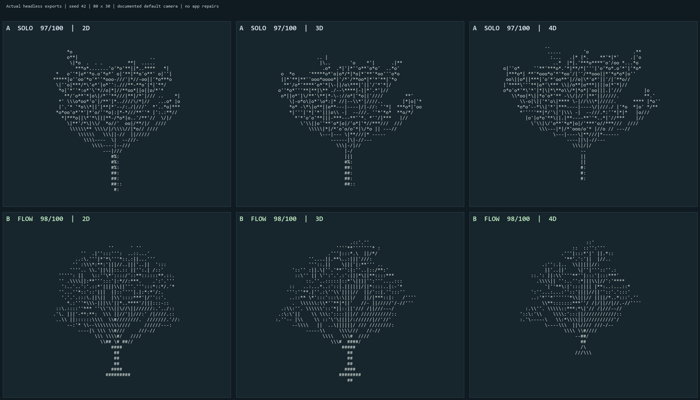

# Codex Flow

`workflow list` находит ID сохранённых задач; `--state paused --json` задаёт фильтр
и машинный вывод. Список и статус читают SQLite без изменений. `status ID --human`
показывает причины остановки стадий, исчерпание бюджета и следующий шаг.

[English](README.md) · [Начало работы](docs/getting-started.md) · [Архитектура](docs/architecture.md) · [Ограничения](docs/limitations.md)

Codex Flow развивает существующий skill версии 1.2.0: к его маршрутам работы и офлайн-установщику добавлен **проектный runtime с явным включением**. Он запускает штатный Codex CLI, координирует независимые подзадачи, сохраняет диагностику и позволяет проводить контролируемые A/B-эксперименты.

Главный профиль — `gpt-6.1-sol`, reasoning `xhigh`. Mercury и локальные пробы по мотивам Harness² по умолчанию выключены. Репозиторий пока приватный; лицензия проекта не выбрана. Универсальное ускорение или экономия квоты не доказаны.

[Постоянный workflow](docs/workflows.ru.md) сохраняет в проектной SQLite состояние
**подготовки → генерации → приёмки → отчёта**. Попытки работают в отдельных снимках;
resume повторно использует проверенные хешами стадии, сохраняя счётчик запросов
и учтённое активное время. Исходный проект автоматически не изменяется.
Команды: `workflow start`, `status`, `pause`, `resume`, `cancel`.
Для существующего Python-проекта с unittest команда `workflow init` создаёт
версионируемый проверяющий без исполнения кода проекта. После настройки
`workflow start "Задача" --dry-run` использует этот явно выбранный контракт.
Исходные тесты фиксируются по байтам; ноль тестов не считается успехом.
`workflow status ID --human` показывает стадии и оставшийся бюджет; прежний JSON
сохранён. [Каталог моделей](docs/model-roles.ru.md) учитывает GPT-6.1 Terra как
кандидата с выключенным запуском. Модельные эксперименты остаются на паузе;
Sol XHigh остаётся главным. [Инструкция](docs/workflows.ru.md).
[14 реальных контролей sandbox и полный фиктивный workflow](benchmarks/workflow-setup-20261027/README.ru.md)
проверяют настройку без вызовов моделей.
[Реальные контроли аварии и восстановления](benchmarks/workflow-recovery-20261027/README.ru.md)
прошли с фиктивным генератором и официальным Windows sandbox: один вызов
генератора и восемь проверок на workflow, включая продолжение только отчёта.
Модель в этих контролях не вызывалась. [Принятая фикстура](examples/workflow-recovery/README.ru.md).

В обычный `run` добавлен [внешний барьер приёмки](docs/acceptance-gate.ru.md).
Явный `--acceptance-file` задаёт проверяющего владельца: `completed_verified`
и `accepted: true` возможны только после его проверок в sandbox. Без контракта
завершение остаётся непроверенным. Отдельный `verify` не вызывает модель.
Есть [рабочий пример JSON CLI](examples/acceptance-gate/README.ru.md) и
[семь реальных контролей sandbox](docs/evidence/acceptance-gate-sdk-20261026.json):
исправный результат, намеренная ошибка, пустой/старый/отсутствующий отчёт,
тайм-аут и фактические запреты чтения/записи. Это проверка приёмки, без нового
заявления об ускорении модели.

Первый независимый помощник — `reviewer/high`: он разбирает риски приёмки по
переданному заданию. Критическую реализацию и проверки выполняет главный агент;
предложения кода от medium-помощников ограничены независимыми задачами низкого риска.

Последняя [серия из двух CLI-задач](benchmarks/efficient-cli-suite-20261026-02/README.ru.md)
завершила обе ветки Solo и Flow в пределах 1500 секунд и 80 физических запросов.
Все четыре неизменённых приложения получили **100/100** при независимой SDK-проверке.
Flow затратил **719,281 против 599,609 с** на Ledger и **1207,984 против 925,687 с**
на SafeZip: примерно **на 20,0% и 30,5% дольше**. Цель ускорить работу без потери
качества **не достигнута**. Более медленная политика делегирования тестовых
предложений сохранена в точном замороженном снимке и не включена в текущую
политику. По умолчанию остаётся краткий разбор рисков `reviewer/high` по переданному
контексту; shell-инструмент этой роли выключен. Прежние серии с
[ошибками транспорта](benchmarks/cohesive-suite-20261024-02/README.ru.md) и
[незавершённой веткой](benchmarks/resilient-cli-suite-20261026-01/README.ru.md)
сохранены. Доступны [CLI-демо](benchmarks/efficient-cli-suite-20261026-02/README.ru.md#запустить-включённые-cli-демо)
и [откат в отдельный каталог](docs/rollback.md#before-the-cli-recovery-changes).

Полная [серия из трёх задач](benchmarks/stream-suite-20261024-01/README.ru.md)
завершила **все шесть веток и 147 native-запросов без ошибок транспорта**.
Баллы A/B: дерево **98/96**, платежи **100/100**, ZIP **100/100**. Flow быстрее
на дереве на 3,419%, но медленнее в двух других задачах; ускорение без потери
качества **не доказано**. Сохранены все 130 файлов решений и реальные демо.
Исправление reader прошло 279 офлайн-проверок на Linux; Windows — 258 успешных
и 21 платформенный пропуск. [Case08](benchmarks/case08/README.ru.md) и прежние
отрицательные результаты сохранены. [Откат](docs/rollback.md) не перезаписывает
текущие правки и не меняет настройки основного компьютера.

Отдельный [контроль новой политики](benchmarks/tree-confirmation-20261024-10/README.ru.md)
получил **Solo 88 / Flow 94**. Flow завершён за 1344,609 с и прошёл native 57/57;
Solo достиг лимита 1500 с, его Ctrl+C-проверка не завершилась. Строгое сравнение
скорости не засчитано. Оба отрицательных вывода сохранены; доступны рабочие демо,
неизменённые исходники и точные снимки runtime.

## Первый запуск

Нужны Python 3.11+ и уже установленный Codex CLI. Для бенчмарка предпочтителен Python 3.12. Runtime использует стандартную библиотеку, не устанавливает зависимости и не создаёт платные API-подключения.

```powershell
python codex-flow.py --help
python codex-flow.py doctor
python codex-flow.py run "Описать небольшую согласованную задачу" --dry-run
```

`doctor` проверяет CLI и вход по подписке без генерации ответа. `doctor --deep` дополнительно читает через CLI метаданные аккаунта и доступных моделей. Это не проверка успешной генерации.

Для выполнения после просмотра плана:

```powershell
python codex-flow.py --repo <project> run "Выполни согласованную задачу" --enable --single-agent
```

Замените `<project>` реальным путём. Глобальные параметры `--repo`, `--codex`, `--config` указываются перед подкомандой. Используется существующий вход ChatGPT; генерация расходует квоту подписки. Автоматический переход на платный API запрещён.

## Реально доступные команды

| Команда | Что делает |
|---|---|
| `doctor [--deep]` | Проверка CLI/входа; опционально метаданные моделей |
| `integrations status` | Показывает настройки интеграций без заявления о доступности |
| `run` | Планирует маршрут и при явном включении запускает задачу |
| `runs list/show/cancel/replay` | Метрики, запрос отмены и сводка сохранённых событий |
| `benchmark tree/report` | Запуск A/B с абляциями или чтение собранных метрик |

Runtime не содержит TUI, живого dashboard или команды `resume`. `runs replay` разбирает журнал и не повторяет вызовы модели. Разговорные маршруты review/resume/checkpoint исходного skill сохранены отдельно.

## Агенты и интеграции

Параллельный маршрут зависит от числа независимых шагов и владения файлами. Координатор объединяет результаты и остаётся автором приложения; помощники собирают независимые свидетельства и выполняют review. `--single-agent` либо `--strategy single` выбирает одиночную работу. `--strategy parallel` не отменяет проверку независимости. `--max-agents` принимает 1–3: это нативный предел одновременно работающих помощников. Пользовательские роли наследуют разрешения родителя; их read-only-режим, общее число помощников и глубина делегирования ограничены инструкциями, без отдельного жёсткого sandbox для каждой роли.

Mercury подключается только через явно выбранный внешний free-only adapter. Его исходники и ключи не входят в поставку. Текущая версия прошла реальную проверку typed-решения с подтверждённой нулевой стоимостью после передачи существующего системного прокси Windows в дочерний Node через `--use-env-proxy`. Модель, build и provider проверены; значения прокси не записывались в журнал, глобальные настройки не менялись. По умолчанию Mercury выключен. Ранее замороженный бенчмарк использует прежнюю версию с 0 успешных вызовов: поздняя проверка не меняет задним числом его статус.

При включении защитный механизм по мотивам Harness² явно откладывает неподтверждённую калибровку: автоматических онлайн-проб нет, старые инструкции по результатам проверки плана не применяются. Явная библиотечная диагностика плана сохраняется, но не может принять предложение. Это устраняет расход времени до реализации; улучшение качества оптимизатором не доказано. Upstream-исполнитель Harness² не запускается. Исторические результаты сохранены с прежним поведением.

## Границы безопасности

Runtime выключен до `--enable` или настройки проекта. Loopback gateway принимает запросы только с одноразовым секретом текущего запуска и пересылает их на фиксированный официальный адрес подписки. Общий жёсткий бюджет — до 80 inference-запросов, включая пробы. Авторизацию передаёт штатный CLI в памяти: токены не копируются в проект, глобальные конфиги не переписываются. Журнал разделяет запрошенные model/effort, фактическую модель ответа и usage; effort не подтверждается отдельным полем ответа.

Одиночная сессия ephemeral. Родитель параллельного запуска сохраняется: нативным помощникам нужен rollout родителя. Пути SQLite и логов, HOME/temp/cache размещаются в проекте; контейнер штатной авторизации и rollout остаётся общим. **Отдельные пути не означают отдельный контекст:** native CLI может восстановить исторические метаданные чужих задач из общего rollout-контейнера в локальную SQLite. Это подтверждённое ограничение платформы для строго независимых профилей. Native-базы, журналы SQLite и сырые native-логи нельзя публиковать.

На Windows взаимные deny-правила разных веток мешали друг другу через общий ACL `CodexSandboxUsers`. Все ветки получают одинаковый запрет уже существующих путей оценщика и прежних решений. Чтение текущей соседней ветки запрещено инструкцией, но физически не изолировано; общее native-состояние тоже не изолировано. Проверка собственных журналов B/C/D не обнаружила вызовов spawn и буквальных признаков чтения соседней ветки или native-state. Это ограниченное наблюдение, а не доказательство отсутствия любого такого чтения. У A был ephemeral-режим без аналогичного сохранённого журнала. Несуществующие deny-пути не допускаются: Windows SDK создавал вместо них каталоги.

Gateway суммирует usage только при полном завершении всех наблюдаемых запросов с корректными счётчиками. Число запросов не доказывает число агентов. Неизвестные итоги, изменение квоты и фактическая стоимость остаются `null`, а не нулём; usage главной CLI-сессии сохраняется отдельно. Обёртка выполняет одну попытку задачи. Проектная настройка `native_request_retries: 1` явно включает один native HTTP-повтор и ограниченное восстановление в общем лимите времени и физических запросов. По умолчанию стоит `0`; stream-повторы и самостоятельный replay gateway выключены. Подробности — в [настройках](docs/configuration.md#bounded-http-recovery).

## Состояние экспериментов

В замороженном case02 приложения получили A=95, B=97, C=95 и D=96 при нуле успешных Mercury-вызовов и неподтверждённых помощниках. В последующем [case04](benchmarks/case04/README.ru.md) оценки A/B/C/D составили 89/83/96/90; все артефакты прошли зафиксированный порог приёмки. B/C выполнили по одному реальному Mercury-вызову, B/D — по две локальные пробы; помощники не подтверждены. A/B/D остановлены по лимиту времени. Это сравнение качества артефактов, без доказанного ускорения или успешного полного многоагентного A/B. Case01 исключён, case03 остановлен; исходные записи сохранены. Подробности — в [протоколе сравнения](docs/benchmarking.md).

В финальном [case05](benchmarks/case05/README.ru.md) подтверждены реальные помощники B/C/D — 1/2/1, по одному Mercury-вызову B/C и по две локальные пробы B/D. Баллы: **A=97, B=89, C=89, D=94**; все артефакты приняты. A завершил работу за 1463,437 секунды; B/C достигли лимита времени, D остановился из-за ошибки открытия соединения с backend. В этом случае одиночный вариант получил лучший балл. Ускорение, экономия квоты и причинный вклад компонентов не установлены. [Проверенные исходники](benchmarks/case05/solutions/README.ru.md) сохранены без исправлений; поздний security-патч команд просмотра не меняет замороженный эксперимент.

## Запуск принятых демо

Независимый [повтор case06](benchmarks/case06/README.ru.md) сохранил дословное задание, оценщик, рубрику, Sol XHigh и лимиты 1500 секунд/80 запросов. После удаления неподтверждённой калибровки и переноса рабочих артефактов, документации и проверок на более ранний этап **solo получил 97, обновлённый Flow 98**. Оба завершились и прошли 57/57 реальных терминальных проверок. Один балл разницы относится только к эстетике. Время процессов — 1444,484/1414,000 с, запросы — 43/36. У Flow подтверждены один помощник и один бесплатный Mercury-вызов; guard Harness² отложил калибровку, онлайн-проб нет. Один повтор не доказывает универсальное ускорение, пользу активного оптимизатора или экономию квоты. Сохранены [разбор причин](docs/decisions/0002-remove-proxy-calibration-prefix.md) и [неизменённые новые исходники](benchmarks/case06/solutions/README.ru.md).



Это шесть реальных headless-экспортов принятых A/B case06, оформленных без повторного запуска или исправления приложений. Это не снимок интерактивного окна. Все четыре [приложения case05](benchmarks/case05/solutions/README.ru.md) сохранены с описанными дефектами. Отдельные поддерживаемые [демо case02](examples/ascii-tree/README.ru.md) проходят Windows/Ubuntu CI.

[Анимация настоящего 4D-поворота XW](benchmarks/case05/rotation.gif) получена после оценки из неизменённого case05 A.

```powershell
Push-Location benchmarks/case06/solutions/B
python -m ascii_tree view --seed 42 --mode 4d
Pop-Location
```

Клавиши `1`, `2`, `3` переключают измерения, `[` / `]` вращают в 4D, `Q` завершает работу. Для демо не нужны модельный аккаунт и установка пакетов.

## Совместимость, проверка и откат

Исходный офлайн-инструмент работает отдельно и без вызова модели:

```powershell
python payload/codex-flow/scripts/flowctl.py doctor
python payload/codex-flow/scripts/flowctl.py install --dry-run
python -m unittest discover -s tests -v
```

Перед обновлением проверьте dry-run и сохраните локальные изменения. Настроенные вручную маршруты Obscura/Chromium нужно согласовать с новой версией; принудительная замена не является безопасным обновлением. Установщик сохраняет резервные копии и защищает свой блок глобальных инструкций.

Для остановки используйте `runs cancel <run-id>`; для запрета будущих запусков уберите явное включение и задайте `enabled: false`. Полный порядок восстановления описан в [rollback](docs/rollback.md). [Аудит совместимости](docs/baseline-compatibility.md), [настройки](docs/configuration.md), [интеграции](docs/integrations.md), [протокол сравнения](docs/benchmarking.md), [диагностика](docs/troubleshooting.md), [безопасность](SECURITY.md), [варианты лицензии](docs/license-options.md).
