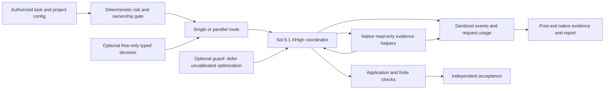

# Architecture

Codex Flow has two compatible layers. `payload/codex-flow/` retains the 1.2.0 skill and offline helper. `codex-flow.py` imports the opt-in implementation from `runtime/codex_flow/`. Existing CLI contracts remain separate rather than being replaced by a new installer.

| Module | Responsibility |
|---|---|
| `cli.py`, `config.py` | Public command parsing, bounded project-local settings and explicit enabling |
| `contracts.py`, `policy.py` | Serializable task/route records, dependency readiness and deterministic routing |
| `native.py` | Native CLI discovery, subscription check, process-local overrides, timeout/cancellation |
| `native_metadata.py` | Post-exit read-only evidence for the exact observed root and its used direct children; hashed identities only |
| `subscription.py` | Nonce-protected loopback forwarding to fixed subscription upstream, shared request budget and response metadata |
| `mercury.py`, `harness.py` | Optional external typed decisions and project-local measured proposals |
| `telemetry.py`, `doctor.py`, `benchmark.py` | Sanitized evidence, metadata preflight and experiment lifecycle |

## Task execution

1. Parse configuration and task text; reject unknown fields or unsupported bounds.
2. Select single or parallel execution from independence and risk rules. An optional validated Mercury result is advisory.
3. Start one root Sol XHigh native turn with explicit sandbox/config overrides. Native delegation belongs to that turn; helpers have bounded instructions and ownership.
4. Observe native events plus subscription request/completion metadata; preserve root usage and complete gateway totals separately.
5. Return completion state and artifacts for independent verification.

`ExecutionPlan.ready_batches()` validates dependency identifiers, rejects cycles and avoids overlapping paths within one batch. It is a library contract; the current `run` command does not automatically extract a complete task graph from arbitrary prose.

The coordinator is the sole integrator/writer. Generated native role files request Sol medium for default/worker/awaiter, Sol high for reviewer and Luna medium for explorer. All instruct helpers to gather evidence without application writes or further delegation. They **inherit parent permissions**; no hard per-role read-only sandbox or delegation-depth enforcement is claimed. Their configured names are not evidence that workers actually ran.

For an admitted parallel invocation, developer instructions explicitly require one read-only helper as the first tool action. After process exit, the observer checks only the exact CLI-observed root ID/cwd and JSON-linked direct child metadata with positive usage. Missing/incompatible metadata stays unknown. `orchestration_status` is `verified` only with accepted native evidence, otherwise `degraded` with `helper_not_observed`; this is separate from application completion and does not prove helper completion, hard depth enforcement or peak agent concurrency.

## Subscription transport

The native CLI supplies subscription authentication to a `127.0.0.1` gateway with a fresh per-run nonce. It forwards only the fixed official `https://chatgpt.com/backend-api/codex` models/responses routes, disallows redirects and API-key-style credentials, and never chooses an alternate provider. Request bodies and completed responses are bounded; sensitive payloads are processed in memory rather than persisted in telemetry.

One locked `RequestBudget` limits inference requests across a task's planning probes, root and gateway-routed helpers to at most 80. Metadata GETs are counted separately. The gateway records requested model/effort, response `actual_model`, completion usage and status. The response does not independently echo reasoning effort. Complete totals require every observed request to finish with valid usage; requests alone do not identify agents.

## Optimization boundary

`GuardedHarness` records a proposal, measured baseline/candidate evidence and an eligibility decision. Safety and completeness must both pass; improvement is higher quality, or equal quality with shorter measured duration. Adoption is explicit and project-local. Rollback checks that the adopted file is unchanged before restoring the previous text.

When enabled, the runtime guard defers uncalibrated optimization without model calls or implicit loading of old overlays. The explicit library planning diagnostic remains available, but cannot adopt instructions: plan coverage and faster plan generation do not establish application quality. Historical cases retain their original probes and adoption records. This is Harness²-inspired behavior, not execution of the upstream optimizer.

The coordinator policy requests an early runnable slice, current documentation, one bounded helper review while implementation continues, and a final 20 percent planning reserve for verification and handoff. The reserve is an instruction, not an enforced phase timer. The outer task timeout and shared request cap remain enforced.

## Evidence boundary

Run JSONL events have timestamps, trace/task identifiers, event type, sanitized payload, duration and error category. Root usage and gateway all-request usage have separate fields. Missing/incomplete aggregate usage remains `null`. Concurrent-helper cap is native configuration; read-only ownership, maximum total helpers and depth are instruction-only limits. There is no live TUI or authoritative billing ledger.

Single-agent parents are ephemeral; parallel parents are persisted because native workers need their rollout. SQLite/logs are project-local, but the native auth/rollout container remains shared. Separate worktrees isolate writes and artifact locations, not read confidentiality. Reciprocal Windows profiles interfered through shared `CodexSandboxUsers` deny ACLs, so all benchmark arms now use the same existing-target deny policy. Hidden evaluator/prior solutions are protected; current-peer reading remains prohibited by instructions and physically soft. This is explicitly degraded isolation.
